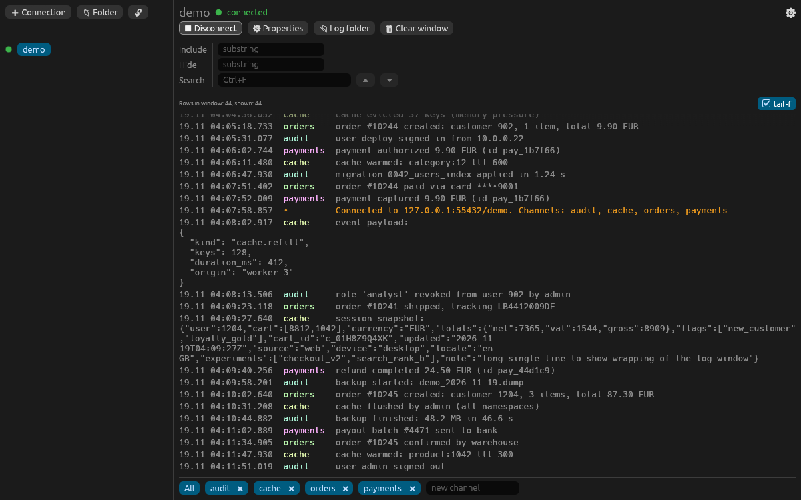

# PgListener

[](#license)
[](https://github.com/steelunicorn/PgListener/releases/latest)
[](#building-on-windows)

[Русский](README.ru.md) · **English**

A Windows application (also runs on Linux/macOS) that listens to PostgreSQL `LISTEN/NOTIFY` channels, writes them to files with daily rotation and shows the log in real time.

It is written in Rust with an egui GUI and ships as a single `pglistener.exe` about 11 MB in size (~5 MB after UPX packing), which needs only the standard Windows DLLs. SQLite, TLS, SSH and fonts are built in.

> The application UI is currently in Russian. UI labels are translated in this document, with the original Russian wording in quotes where it matters.

## Screenshot



## Download

**[Download the latest release](https://github.com/steelunicorn/PgListener/releases/latest)** — `pglistener.exe` for Windows x64. It is portable: put the file in any folder and run it, no installation is needed. The Visual C++ Redistributable is not required either. Settings (`pglistener.db`) and logs (`logs\`) are created next to the exe.

The released exe is not code-signed, so on the first launch SmartScreen may show a warning: click «More info» → «Run anyway».

There are no ready-made builds for Linux/macOS, but the project builds from source — see “Building on Windows” below.

## Contents

- [Screenshot](#screenshot)
- [Features](#features)
- [Logs](#logs)
- [Bridge](#bridge)
- [PostgreSQL logging function](#postgresql-logging-function)
- [Building on Windows](#building-on-windows)
- [Graphics](#graphics)
- [Source layout](#source-layout)
- [Security](#security)
- [Feedback](#feedback)
- [License](#license)

## Features

- A connection catalog with nested folders. Creating, renaming, deleting and moving are done through the context menu (right mouse button) and the buttons above the tree.
- A connection stores its name, host, port, database, login, password, SSL mode (`disable`, `prefer`, `require`) and log directory. An SSH tunnel can be enabled, authenticating with a password (with keyboard-interactive as a fallback) or with an OpenSSH/PEM key, including a passphrase-protected one.
- Channels are added and removed on the fly, without reconnecting: in the “Channels” row of the main window or in the connection properties. The chips in that row toggle visibility: a click hides or shows the rows of a channel, the right button means “show only this channel”, ✖ stops listening to a channel; the “All” button brings all channels back.
- The log is shown as a single list (“All”, including service messages marked `*`); which channels are visible is defined by the channel chips. The window keeps the last 20,000 messages since the application started, even if the calendar day has changed; when a connection is opened the history is loaded from files, and a reconnect does not discard the rows already shown. Long messages wrap to the window width (there is no horizontal scrolling), and line breaks inside a message are displayed as is; continuation lines have no indent and start at the left edge.
- Log tailing: the “✓ tail -f” chip to the right of the “Lines in window…” row. While it is on, the window stays on the last line and new messages scroll it down. Jumping to a search match turns tailing off (even if the match happens to be at the bottom), as does scrolling up manually; it can be turned back on with a chip click or by scrolling to the bottom yourself. Clearing the search neither moves the view nor restores tailing. The state is per connection and is not persisted between runs.
- Substring filters, case-insensitive, stored per connection:
  - “Show only lines containing” — if at least one is set, only lines containing any of the substrings are visible;
  - “Hide lines containing” — lines containing any of the substrings are hidden (applied after the include filter).
- Search over the shown lines: queries can be pinned — Enter adds the entered query to the list, each query has its own highlight color and its own navigation (⏶/⏷ in its chip), Shift+Enter or the ⏷/⏶ buttons walk all matches, “Reset” removes the pinned queries. Ctrl+F jumps to the search field, Esc clears the field (or all pinned queries if the field is empty). Matches are highlighted, the current one is orange, the counter shows “N of M”. A new query selects the most recent match.
- Selecting text in any log line with the mouse (drag or double-click a word) highlights all its occurrences in the shown lines in blue, case-insensitively. The highlight disappears when the selection is cleared. Selections spanning several lines are not highlighted.
- A bridge for the local network: PgListener accepts connections from other computers and forwards them to the database (see “Bridge”).
- On connection loss the application reconnects by itself with delays of 1, 2, 5, 10, 20 and 30 s. Once every 30 s the connection is checked with a `SELECT 1` query.
- Minimizing to the tray (Windows): a minimized window hides in the notification area. The window comes back with a click on the icon, and the icon menu can be used to exit. Enabled in the settings (⚙ button) with the “Minimize to tray” checkbox.
- Appearance: “system”, light, dark and “Matrix” themes (muted green). The ⚙ button in the header opens the settings: the RU|EN language switch and the theme selector in the top row, “Minimize to tray”, “Service messages” and the renderer name line; with software rendering a warning is displayed there as well.
- Interface language: Russian or English, the RU|EN switch in the settings next to the theme selector. On the first run the language comes from the Windows locale (Russian locale — Russian, otherwise English) and is remembered in `pglistener.db`. Until a language has been chosen, it can be set with the `PGLISTENER_LANG=ru` or `PGLISTENER_LANG=en` environment variable. Already received messages are not retranslated, neither are connection, folder and channel names.
- On startup the application asks whether to restore the connections that were active when it was closed.
- Connection passwords can be encrypted with a master password (see “Security”).
- Portable mode: settings are stored in `pglistener.db` (SQLite), logs in `logs\`, both next to the exe.

## Logs

```
<exe folder>\logs\<log directory>\<channel>.log              current day
<exe folder>\logs\<log directory>\<channel>.2026-10-22.log   previous days
```

The log directory is set in the connection properties. If the field is empty, the connection name is used (characters not allowed in file names are replaced with `_`). The line format is `2026-10-23 11:24:10.944: message text`.

Service messages (`*`: connection, errors, bridge) are shown only in the log window and are not written to files. Old versions may have left `_pglistener*.log` files next to the logs; the application no longer reads them.

## Bridge

The bridge lets other computers on the local network connect to the database through the machine running PgListener. This is handy when the database is reachable only from that machine, for example through an SSH tunnel.

The bridge is enabled in the connection properties with the “Bridge: let local network clients reach the database” checkbox. It configures:

- the listen address: `0.0.0.0` means all network interfaces, `127.0.0.1` means this computer only;
- the port, `15432` by default;
- allowed addresses: IPs and subnets separated by commas, for example `192.168.1.0/24, 10.0.0.5`. An empty list allows everyone.

The bridge works while the connection is active and does not depend on whether the LISTEN connection succeeded. Every incoming TCP connection is forwarded to the database server directly or through the connection's SSH tunnel. All SSH connections share a single SSH session.

On another computer, point DBeaver, psql or your application at the PgListener machine and the bridge port. The database name, login and password are entered by the client: PgListener only forwards traffic and does not substitute the saved credentials. SSL works directly between the client and the server.

Connections, disconnections and rejected addresses are reported in the service messages of the log window (`*`).

Things to keep in mind:

- on the first bridge start Windows asks for a firewall permission; it must be granted for network access;
- in `pg_hba.conf` all bridge clients look like the PgListener machine, and with an SSH tunnel like the SSH server itself;
- changed bridge settings are applied immediately: the active connection reconnects.

## PostgreSQL logging function

Run [`sql/log_notify.sql`](sql/log_notify.sql) in the database (PostgreSQL 14+).

```sql
CREATE FUNCTION app.process_orders(n int) RETURNS void LANGUAGE plpgsql AS $$
BEGIN
    PERFORM log_notify('orders', 'обработано ' || n || ' заказов');
END $$;

SELECT app.process_orders(10);
-- the orders channel receives: [app.process_orders] обработано 10 заказов
```

The caller's function name is determined from the call stack. It works for functions, procedures and trigger functions. The schema is included in the name if the function is not visible through `search_path`. Calls from an anonymous `DO` block produce `[DO]`, calls made directly from SQL produce `[SQL]`. PostgreSQL usually inlines `LANGUAGE sql` functions into the calling statement, so they also produce `[SQL]`. Messages longer than 8000 bytes (the NOTIFY limit) are truncated with `…` at the end.

NOTIFY quirks worth remembering:

- notifications are delivered only after `COMMIT`, and are lost if the transaction rolls back;
- identical messages to the same channel within one transaction are merged into one;
- while the application is not connected, messages are not stored anywhere — that is how LISTEN/NOTIFY works.

## Building on Windows

1. Install **Rust** from https://rustup.rs (`rustup-init.exe`, the default `x86_64-pc-windows-msvc` toolchain).
2. Install **Visual Studio Build Tools** (https://visualstudio.microsoft.com/visual-cpp-build-tools/) with the “Desktop development with C++” workload. MSVC and the Windows SDK are needed: SQLite and the `ring` crypto library are built from C. If Rust was installed with rustup-init, it offers to install the Build Tools itself.
3. In the source folder run:
   ```
   cargo build --release
   ```
4. The binary appears at `target\release\pglistener.exe`. Copy it to any folder and run it. The Visual C++ Redistributable is not needed: the C runtime is statically linked, which is configured in `.cargo\config.toml`.

The first build takes 3–10 minutes because the dependencies are downloaded and compiled.

### Build script

`build.cmd` (double-click) or `.\build.ps1` in PowerShell builds the release, puts `pglistener.exe` in the folder above the sources and, if everything succeeded, deletes the `target` folder (`cargo clean`). On error `target` is kept. Parameters:

- `-OutDir <folder>` — where to put the exe;
- `-KeepTarget` — do not delete `target`; the next build will then be faster.

Without `-KeepTarget` every build starts from scratch and takes the same 3–10 minutes.

Next to the resulting exe (the folder above the sources) there is its own `build.ps1` / `build.cmd` wrapper: it runs the same build and puts the exe in its own folder. With the `-Upx` switch the resulting program is additionally packed with UPX (looked up in `PATH` or in `..\tools\upx.exe`) and verified with `upx -t`; if packing fails, the plain exe is kept and an error is printed.

### Cross-compiling the exe from Linux

```bash
sudo apt install mingw-w64
rustup target add x86_64-pc-windows-gnu
cargo build --release --target x86_64-pc-windows-gnu
# result: target/x86_64-pc-windows-gnu/release/pglistener.exe
```

### Building on Linux/macOS

```bash
cargo build --release      # result: target/release/pglistener
```

On Linux, building requires `libssl-dev`, and running requires `libxkbcommon-x11-0` (X11) or Wayland.

## Graphics

The window is rendered with OpenGL. If OpenGL is unavailable (RDP, a virtual machine without a 3D driver: Windows then only provides OpenGL 1.1), the application switches to DirectX 12 (wgpu) by itself. Without a GPU, DirectX 12 renders in software (WARP), and scrolling and log updates noticeably load the CPU.

With a GPU, both methods use the same amount of CPU, but OpenGL takes three times less memory (about 30–40 MB versus 110 MB).

The active renderer is shown in the settings (⚙ button, the renderer name line); with software rendering a warning is displayed there too. The renderer can be forced with the `PGLISTENER_RENDERER=opengl` or `PGLISTENER_RENDERER=dx12` environment variable.

## Source layout

| File | Purpose |
|---|---|
| `src/main.rs` | startup, renderer selection |
| `src/app.rs` | UI: connection tree, log, filters, search, themes, dialogs |
| `src/i18n.rs` | UI strings in Russian and English, language selection |
| `src/worker.rs` | SSH tunnel, PostgreSQL connection, LISTEN/UNLISTEN, reconnecting |
| `src/bridge.rs` | bridge: accepting network connections and forwarding them to the database |
| `src/logfile.rs` | writing logs with daily rotation, reading the current day's lines |
| `src/tray.rs` | tray icon (Windows), application icon |
| `src/crypto.rs` | password encryption (AES-256-GCM, Argon2, DPAPI) |
| `src/storage.rs` | storing folders and connections in SQLite |
| `src/model.rs` | shared types |
| `sql/log_notify.sql` | logging function for PostgreSQL |
| `build.ps1`, `build.cmd` | release build, installing the exe above the sources and cleaning `target` |
| `LICENSE-MIT`, `LICENSE-APACHE` | license terms (dual license, see “License”) |

## Security

### Master password

Database, SSH and key passphrase passwords can be encrypted with a master password: the 🔓/🔒 button above the connection tree.

- Encryption is AES-256-GCM, the key is derived from the master password with Argon2id. Only the salt and a verification value are stored in the database; the master password itself is never saved anywhere. Names, hosts, logins and channels are not encrypted.
- On startup the application asks for the master password. If “Remember on this computer” is checked (Windows only), the key is stored in the database protected by the DPAPI of the current Windows account. That account is no longer asked for the password, while on another computer or under another user it must be entered again. The folder stays portable.
- In the same dialog the master password can be changed or removed (passwords are then stored in plain text again).
- If the master password is forgotten, the input dialog has a “Forgot password…” option: all saved connection passwords are wiped, the other settings are kept, and the passwords must be entered again.

Without a master password the passwords are stored in `pglistener.db` in plain text.

### Other notes

The SSH server key is not verified (like `AutoAddPolicy` in paramiko/sshtunnel). The PostgreSQL certificate is not verified in the `prefer` and `require` modes either, which is also what libpq does.

## Feedback

Found a bug, have a suggestion or a question — open an [issue](https://github.com/steelunicorn/PgListener/issues). Pull requests are welcome: for larger changes it is better to discuss the idea in an issue first.

## License

The project is distributed under the dual **MIT OR Apache-2.0** license: you may choose either of the two, whichever suits your project better.

- [LICENSE-MIT](LICENSE-MIT) — a short permissive license;
- [LICENSE-APACHE](LICENSE-APACHE) — the same plus an explicit patent license and trademark terms.

Both licenses allow using the code in open and closed products, including commercially, provided the copyright notice and license text are retained. If unsure, MIT is simpler, while companies usually prefer Apache-2.0 (explicit patent guarantees).
